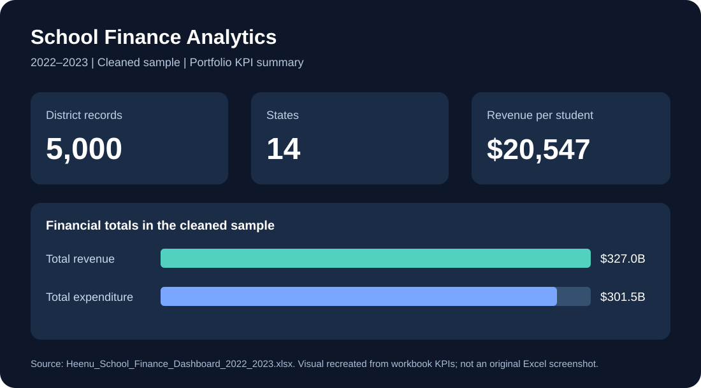
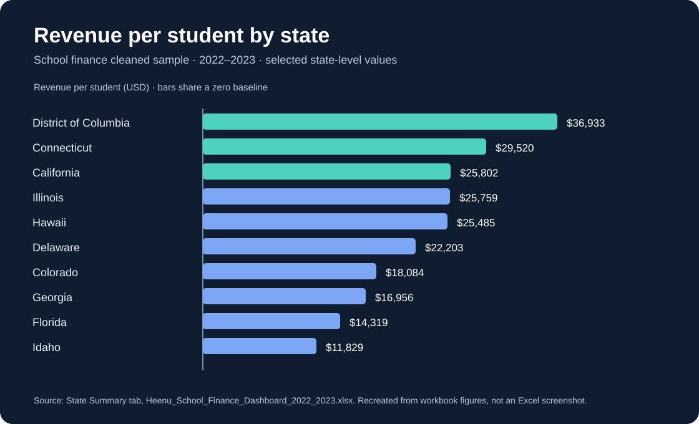

# Heenu Kumari — Data Analytics Portfolio

**M.S. Business Analytics | Santa Clara University | Expected June 2027**  
**Focus:** Data Analyst · Business Analyst · Business Intelligence · Reporting Analyst · Analytics Intern

[LinkedIn](https://www.linkedin.com/in/heenu-kumari-9b062a3b4) · [GitHub](https://github.com/hkumari-a11y)

I turn messy data into understandable metrics, reliable analysis, and actionable reporting. My graduate portfolio includes a school finance dashboard, relational database design, SQL reporting, Python data validation, and model evaluation. I'm seeking opportunities to grow in analytics and business intelligence.

## Featured work

### 1. School Finance Analytics Dashboard | Excel and business reporting

**Business question:** How can school district revenue, expenditure, and enrollment data support clear reporting?

**Verified project scope:** A cleaned sample of **5,000 school district records from 14 states** in the **2022–2023** school finance workbook. The dashboard reports approximately **$327.0B in revenue**, **$301.5B in expenditure**, **15.9M enrollment**, and **$20,547 revenue per student** for that sample.

**Approach:** Standardized headers, excluded invalid negative financial values from KPI calculations, and summarized information by state and district. The figures describe the cleaned sample, **not all US school districts**.

[Explore the capstone repository](https://github.com/hkumari-a11y/business-analytics-capstone)

### 2. Vacation Rental Database Design | PostgreSQL and data modeling

**Business question:** How should properties, guests, and reservations be represented while enforcing relational integrity?

**Portfolio evidence:** Illustrative SQL schema, relationship modeling, and example queries. The implementation is an **independently prepared educational extension** of collaborative coursework, not the group's original submitted design.

[View the database design project](https://github.com/hkumari-a11y/vacation-rental-database-design.)

### 3. Retail Sales and Customer Retention | SQL

**Business question:** How can transaction data answer revenue, average order value, product performance, and repeat-purchase questions?

**Portfolio evidence:** PostgreSQL schema, fictional sample data, reporting queries, and customer-cohort retention analysis.

[Sales KPI project](https://github.com/hkumari-a11y/sql-business-analysis/tree/main/projects/retail-sales-kpi-analysis) · [Customer retention cohorts](https://github.com/hkumari-a11y/sql-business-analysis/tree/main/projects/customer-retention-cohort-analysis)

### 4. Data Quality and Finance KPIs | Python

**Business question:** How can an analyst detect duplicate or missing identifiers and verify financial calculations before reporting?

**Portfolio evidence:** Reproducible Python examples for record matching and KPI validation, using **fictional data**.

[Data quality audit](https://github.com/hkumari-a11y/python-data-analysis/tree/main/projects/data-quality-audit) · [Finance KPI validation](https://github.com/hkumari-a11y/python-data-analysis/tree/main/projects/school-finance-kpi-validation)

### 5. School Revenue Model Review | OLS, KNN, model evaluation

**Academic context:** A collaborative RAFT project explored school matching and school-level revenue modeling. A review of existing group results compared a baseline with OLS and KNN on **66 test schools**. In that comparison, the baseline achieved the lowest overall mean absolute error.

**Portfolio evidence:** A separate synthetic-data Python exercise calculates MAE, RMSE, and median absolute error. **The exercise does not retrain the group's models.** No private school records or confidential project files are published.

[Model evaluation example](https://github.com/hkumari-a11y/machine-learning-project/tree/main/projects/revenue-model-evaluation)

## Technical skills demonstrated

| Area | Skills |
|---|---|
| Data analysis | Data cleaning, data validation, exploratory analysis, KPI definition |
| SQL | Joins, aggregation, grouping, cohort analysis, relational schema design |
| Python | Reusable functions, validation checks, summary statistics, model evaluation metrics |
| Reporting | Excel dashboards, financial metrics, clear documentation |
| Analytical methods | OLS and KNN concepts, baseline comparisons, MAE/RMSE interpretation |

## For recruiters and hiring teams

**Best place to start:** the [school finance dashboard](https://github.com/hkumari-a11y/business-analytics-capstone) for business reporting, the [retail sales SQL project](https://github.com/hkumari-a11y/sql-business-analysis/tree/main/projects/retail-sales-kpi-analysis) for query examples, and the [Python data-quality audit](https://github.com/hkumari-a11y/python-data-analysis/tree/main/projects/data-quality-audit) for reproducible code.

**Project integrity:** Coursework, independent exercises, and collaborative work are distinguished throughout this portfolio. Synthetic-data demonstrations are labeled, and figures from existing workbooks are not presented as real-world client results.

**Connect:** [LinkedIn](https://www.linkedin.com/in/heenu-kumari-9b062a3b4)
