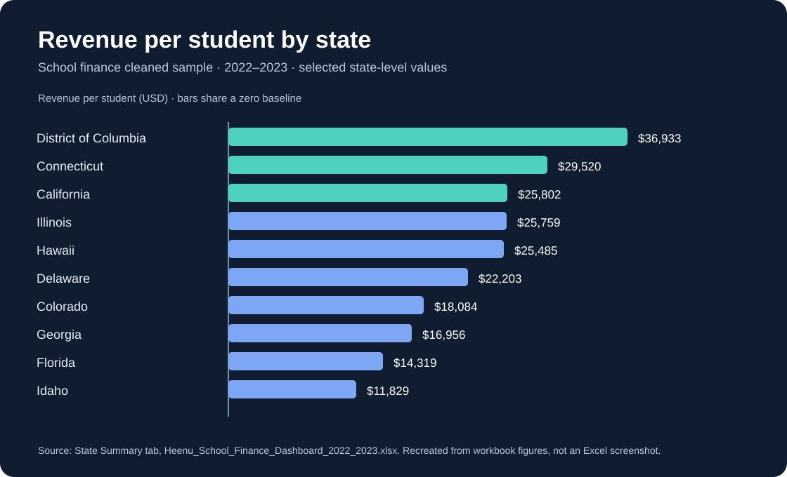
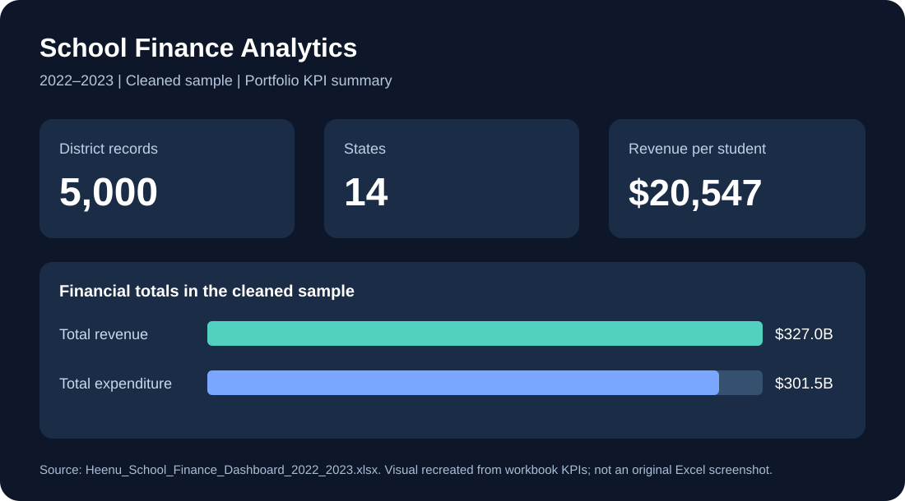

## State-level comparison

The chart recreates selected **revenue-per-student** figures from the `State Summary` worksheet of the 2022–2023 cleaned sample. In this sample, the District of Columbia is approximately **$36,933**, Connecticut **$29,520**, California **$25,802**, and Idaho **$11,829** per student. These are descriptive sample values, not causal comparisons or nationwide estimates.

## School Finance Dashboard Preview

*Visual recreated from verified 2022–2023 cleaned-sample workbook metrics; not an original Excel screenshot. Sample results should not be generalized nationally.*

## My Analytics Portfolio

[Explore my featured projects, skills, and coursework](PORTFOLIO.md).

# School Finance Analytics Capstone

## Overview
Business Analytics capstone project completed as part of my M.S. in Business Analytics at Santa Clara University. The project focuses on analyzing school finance data and communicating financial and operational trends through dashboard-based reporting.

## Objective
- Clean and validate school finance data
- Identify meaningful financial and operational trends
- Track and communicate key performance indicators (KPIs)
- Present findings in a clear format for stakeholder review

## Tools & Skills
**Tools:** Microsoft Excel, Tableau  
**Skills:** Data Cleaning, Data Validation, KPI Reporting, Dashboard Development, Business Analytics, Data Visualization

## Repository Contents
- `Heenu_School_Finance_Dashboard_2022_2023.xlsx` — school finance dashboard workbook

## Business Value
This project demonstrates how structured financial data can be transformed into clear reporting and visual insights that support business analysis and decision-making.

## Author
**Heenu Kumari**  
M.S. Business Analytics, Santa Clara University  
[LinkedIn](https://www.linkedin.com/in/heenu-kumari-9b062a3b4) | [GitHub](https://github.com/hkumari-a11y)

## Portfolio highlights
- **Business question:** How can school finance data be organized into useful financial and operational reporting?
- **Approach:** Prepare and validate data, organize KPIs, and communicate trends in an Excel dashboard.
- **Deliverable:** `Heenu_School_Finance_Dashboard_2022_2023.xlsx` (see the workbook for the actual analysis).
- **Relevant roles:** Junior Data Analyst, Reporting Analyst, Business Analyst Intern.

## How to review this project
1. Open the Excel workbook in this repository.
2. Review its source data, calculations, and dashboard views.
3. Assess the KPIs and trends in the workbook; no numerical outcomes are claimed here without verification.

## Next improvements
- Add a dashboard screenshot and a short summary of 2–3 findings after verifying them against the workbook.
- Document the dataset source and any cleaning assumptions.

## Verified dashboard snapshot (2022–2023)
The project workbook documents a **cleaned sample of 5,000 school-district records across 14 states**, not the complete national dataset. The dashboard reports **$327,009,489,000 total revenue**, **$301,519,309,000 total expenditure**, **15,914,937 total enrollment**, and approximately **$20,547 revenue per student** within that sample.

**Data preparation documented in the workbook:** standardized headers, excluded invalid negative finance values from KPI calculations, and summarized data by state and district.

**Interpretation:** These are descriptive totals for the project's cleaned sample. They should not be generalized to all US school districts. The source workbook is `Heenu_School_Finance_Dashboard_2022_2023.xlsx`.
